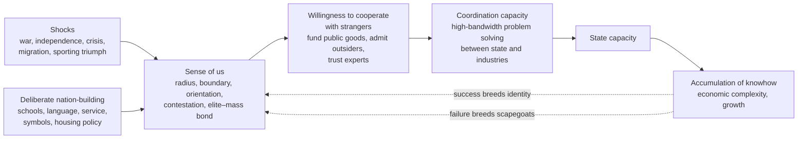

# Analytical framework

Version 0.1, October 2026. This framework turns Ricardo Hausmann's "sense of us" from a lecture concept into something that can be coded, compared, validated and tested. It is a working proposal and is meant to be revised as the pilot produces evidence.

## 1. What the framework has to do

The Growth Lab describes the project as identifying, categorising and cataloguing the unifying features and foundational myths that societies use for their sense of us, then understanding how a sense of us arises, evolves, breaks down or is superseded. That implies four jobs.

1. **Describe** a society's sense of us in a comparable way (the codebook).
2. **Classify** societies into types (the typology).
3. **Explain change** over time (the dynamics model).
4. **Link** the sense of us to coordination, state capacity and growth (the hypotheses).

Most work on national identity does one or two of these. The value here comes from doing all four with one consistent measurement system.

## 2. Core definition

The sense of us is the operative answer a society gives to three questions.

| Question | Dimensions that answer it |
| --- | --- |
| Who are we? | Radius, boundary permeability, nesting |
| What binds us? | Glue, myth arc, salience |
| What are we for, and against whom? | Orientation, contestation, elite–mass bond |

"Operative" matters. Every society has an official story in its constitution and anthem. The framework codes the "us" that governs behaviour, such as who gets hired, who gets taxed to help whom, and whose expertise is trusted. The gap between the official and operative versions is itself a variable (section 5).

## 3. The causal model

Hausmann's own chain runs from the sense of us to complexity. The framework adds the two feedback arrows, because prosperity plausibly builds the "us" and collapse plausibly narrows it. Without those arrows any correlation between identity and growth is uninterpretable.

## 4. Dimensions and mechanisms

The codebook (`codebook/codebook.yaml`) defines nine dimensions. The table explains why each one is there and what it should predict.

| Dimension | Mechanism it captures | Observable implication if Hausmann is right |
| --- | --- | --- |
| Radius | Size of the network people feel obliged to cooperate with | Wider radius goes with larger internal markets, more interregional transfers, fewer secession movements |
| Boundary permeability | Whether knowhow can enter through people | More permeable boundaries go with more skilled immigration, fewer reserved professions, faster diversification |
| Glue | What resources leaders can draw on to hold the "us" together | Civic and modernisation glue travel better across ethnic lines than descent or religion |
| Myth arc | The story that makes sacrifice for the "us" feel meaningful | Strong arcs raise salience; trauma-centred arcs may raise boundary closure |
| Orientation | Whether solidarity is built around a project or an enemy | Enemy orientation buys short-run mobilisation at the cost of openness |
| Contestation | Whether one "us" or several compete for loyalty | High contestation lowers public-goods provision and state capacity |
| Elite–mass bond | Whether experts and ordinary people still feel mutually obliged | A weak bond lowers trust in expertise and raises populist vote shares |
| Salience | How strongly the "us" is felt and how easily it mobilises | Salience amplifies the effect of the other dimensions in both directions |
| Nesting | Whether sub-national and supranational identities compete with the national one | Competing nesting predicts fragmentation; nested identities predict stable federations |

## 5. Four layers of evidence and the myth gap

Each dimension can be observed at four layers. The questions, indicators and data sources for every dimension and layer are in `docs/RESEARCH_DESIGN.md`, generated from `research/framework.yaml`.

| Layer | What it shows | Example sources |
| --- | --- | --- |
| Narrative | What the society says about itself | Constitution preambles, anthems, currency, holidays, textbooks, founding speeches |
| Institutional | What the rules encode | Citizenship law, official languages, reserved professions, fiscal equalisation, conscription |
| Behavioural | What people actually feel and do | National versus ethnic self-identification in surveys, intermarriage, inter-group trust, voting on transfers |
| Lived | How the "us" is experienced, performed and argued about in everyday life and culture | Ethnographies, interviews, festivals, sport, novels, film, music, humour, monuments and street names |

The AI profiles mostly read the narrative layer, with some institutional evidence. The behavioural layer comes from external datasets (Afrobarometer, World Values Survey, ISSP National Identity module, Eurobarometer). The lived layer comes from the ethnography and culture strand: readings in `research/readings/` that say whether lived evidence supports, complicates or contradicts each code. Lived evidence is not scored, but two or more contradicting readings flag a code for review.

The **myth gap** is the distance between the narrative and behavioural codes for the same dimension. A country whose constitution proclaims a civic "us" but whose citizens identify ethnically has a large radius gap. My hypothesis (medium confidence) is that large myth gaps predict breakdowns better than any single level, because they mark an "us" that elites maintain and citizens no longer believe.

## 6. Unit of analysis and time

The unit is a **community-period**. A community is usually a state but can be a sub-state nation (Catalonia, Scotland, the Navajo Nation) or a supranational body (the EU). A period is normally a decade, shorter around turning points.

Every profile has an **evidence cut-off date**. The model is told to use only evidence available before it. This is the main defence against hindsight, since a model that knows Yugoslavia collapsed will tend to find fragility in 1975.

## 7. Building the typology

The typology is developed in three passes, so that theory and data discipline each other.

1. **Deductive priors.** Six hypothesised types sit in the codebook (civic project, ethnic defensive, revolutionary, dynastic-religious, consociational, thin state). Every profile records which one the model thinks fits, or `none_fits`.
2. **Inductive discovery.** The `open_features` field collects everything the codebook misses. `sou open-code` asks Claude to propose new categories from all summaries and open features together. Clustering on consensus profiles (`sou analyse`) shows which groupings the data actually supports.
3. **Reconciliation.** Compare the clusters with the priors. A prior type that never appears gets dropped. A cluster with no prior gets named and defined.

Rules for revising the codebook, recorded in `docs/DECISIONS.md` each time.

| Evidence | Action |
| --- | --- |
| A label appears in open features for 3 or more units | Consider a new glue option or myth flag |
| A dimension has cross-model alpha below 0.4 after two rounds | Rewrite its anchors; drop it if still below 0.4 |
| Two dimensions correlate above 0.8 across units | Merge them or justify keeping both |
| More than 20% of profiles choose `other` for glue | The glue list is incomplete; revise it |
| Hand-coding and model consensus disagree by 2 or more points on a dimension in 2 or more calibration cases | Revisit the anchors before scaling |

Saturation is the stopping rule. When five consecutive new countries add no new open-feature categories, the codebook is ready to freeze for scale-up.

## 8. Dynamics model

The four verbs in the project description become four coded transitions between consecutive periods.

| Transition | Operational definition |
| --- | --- |
| Arises | Salience rises by 2 or more points, or radius widens, without a change of glue |
| Evolves | Glue or orientation changes while radius and contestation stay within 1 point |
| Breaks down | Contestation rises to 3 or more, or radius narrows by 2 or more points |
| Is superseded | A supranational or sub-national "us" overtakes the national one in salience |

Each transition gets coded triggers (war, independence, economic crisis, migration wave, leader change, deliberate policy, sporting or cultural event). With enough country-periods this supports an event-history analysis of which triggers precede which transitions. With the pilot alone it supports structured case comparison.

## 9. Hypotheses

The hypotheses are maintained in `research/framework.yaml` and listed in `docs/RESEARCH_DESIGN.md`. This table is a copy for reading alongside the theory.

| # | Hypothesis | Outcome measure | Data |
| --- | --- | --- | --- |
| H1 | Wider radius predicts more openness to skilled migration, holding income constant | Reserved professions, naturalisation rules, skilled-visa rates | Labour codes, citizenship-law indices, Growth Lab migration openness measure |
| H2 | Enemy orientation raises short-run mobilisation but lowers long-run complexity growth | Tax effort, conscription; change in economic complexity over 20 years | Atlas of Economic Complexity, tax data |
| H3 | Higher contestation lowers state capacity and public-goods provision | State capacity indices | V-Dem, Hanson and Sigman capacity index |
| H4 | A weaker elite–mass bond predicts lower trust in experts and higher populist vote share | Trust in science and civil service; populist vote | World Values Survey, PopuList |
| H5 | Falling acceptance of interregional transfers precedes breakdowns | Regional party fragmentation, transfer disputes | Regional election and fiscal data |
| H6 | Shocks that widen the "us" precede growth accelerations | Growth acceleration episodes | Hausmann, Pritchett and Rodrik acceleration dates |
| H7 | Large myth gaps predict breakdowns better than levels | Secession, civil conflict | UCDP, secession movement data |
| H8 | A civic "us" is more compatible with openness than an ethnic one under economic stress | Migration policy change during recessions | Policy change logs |

## 10. The redundancy test

The concept must earn its place beyond existing measures. The decisive test is whether sense-of-us codes predict H1 to H7 outcomes after controlling for ethnic fractionalisation, generalised trust, democracy and income.

If they add nothing, the concept is a relabelling of fractionalisation and trust. If they add explanatory power, especially orientation, elite–mass bond and the myth gap, which have no close equivalents in existing datasets, the concept is new. I would put roughly even odds on a clear pass with the first 50 countries. That uncertainty is exactly why the test should be designed now and run before strong claims are made.

## 11. Validity and reliability

| Check | Method | Target |
| --- | --- | --- |
| Run stability | Same model, same prompt, three runs | Alpha above 0.7 |
| Model agreement | Two different models | Alpha above 0.6 |
| Language robustness | English versus national-language emphasis | Alpha above 0.6; divergences reported as findings |
| Human agreement | Two experts per pilot country code blind with the same form | Alpha above 0.6 between experts and model consensus |
| Convergent validity | Radius and salience against survey national identification | Positive, moderate correlation |
| Discriminant validity | Codes against fractionalisation and generalised trust | Correlated but clearly distinct |
| Hindsight check | Profiles cut off before known outcomes, compared with profiles where the model is told the outcome | Small difference means the cut-off works |

Language divergence is treated as data. If Slovak-language sources produce a narrower Slovak "us" than English-language sources, that tells you how the country presents itself abroad versus at home.

## 12. Threats to validity

**Circularity.** Coding the "us" from outcomes (Venezuela looks narrow because it collapsed). Defence is cut-off dates and period sources.

**Anglophone and Wikipedia bias.** Models know the English-language version of each nation best. Defence is national-language runs, primary-source packs and national validators.

**False consensus.** Averaging rival narratives into one. Defence is group-perspective profiles and the contestation dimension.

**Essentialism.** Treating a nation's "us" as fixed and singular. Defence is period-based coding and the dynamics model.

**Normative misuse.** A catalogue of effective myths is also a manual for authoritarian nation-building. Orbán, Modi and Erdoğan have built strong coordinating identities. The write-up should state which features correlate with openness and complexity, and which only with mobilisation.

## 13. What would falsify the concept

The concept is in trouble if any of these hold after the scale-up.

1. Sense-of-us codes add no explanatory power beyond fractionalisation and trust (section 10).
2. Experts and models cannot agree on codes (alpha below 0.4 for most dimensions), meaning the construct is too vague to measure.
3. Changes in the "us" follow growth episodes but never precede them, meaning identity is an effect of prosperity and not a cause.
4. Wider radius is unrelated or negatively related to migration openness, which would undercut the knowhow channel at the centre of Hausmann's argument.

## 14. How the framework develops

| Version | Trigger | Main change |
| --- | --- | --- |
| 0.1 | This document | Deductive codebook and hypotheses |
| 0.2 | Three hand-coded calibration cases | Anchors rewritten where hand-coding struggled |
| 0.3 | Twelve-country pilot and reliability report | Weak dimensions redefined or dropped |
| 0.4 | Open coding and clustering | Glue list and myth flags revised; types renamed |
| 0.5 | Human validation | Final anchors; codebook frozen |
| 1.0 | Scale-up to 50 or more countries | Hypothesis tests and redundancy test |
